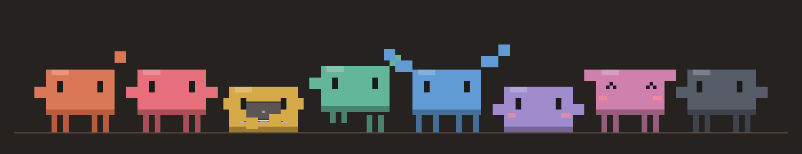
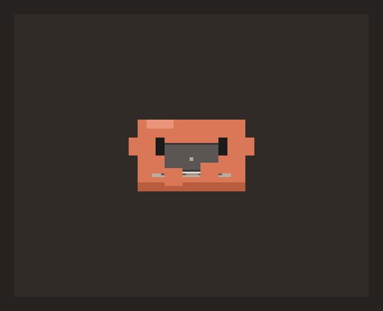
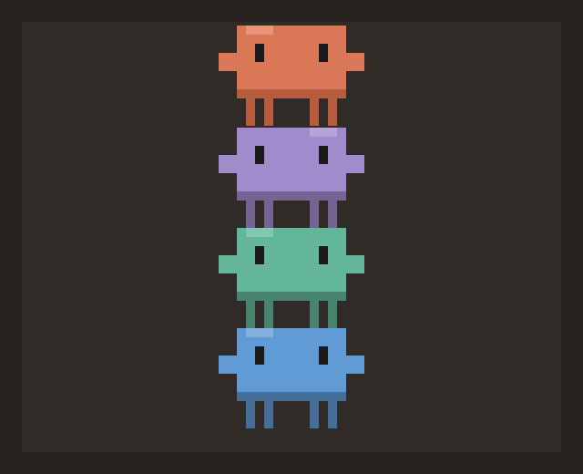
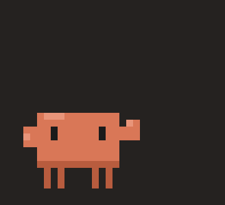
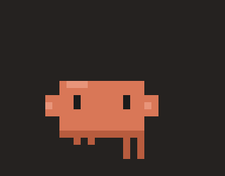
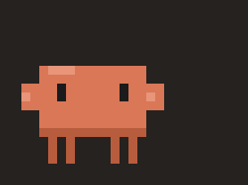
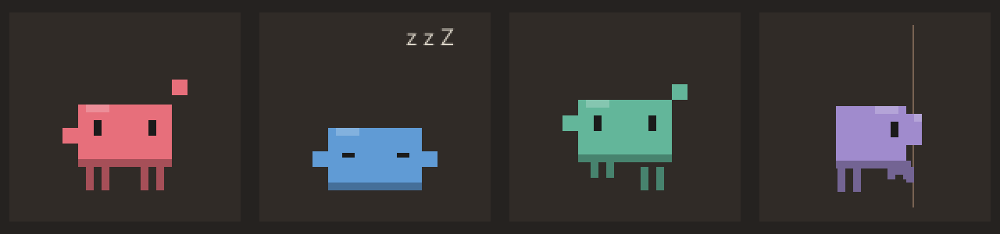

# Claude Mascot Rust

**Маленькая пиксельная компания на твоём рабочем столе.**

Клодики гуляют, смотрят за курсором, достают ноутбук,
играют друг с другом и иногда строят башню.

[**Скачать для Windows**](https://github.com/GredesCerber/claude-mascot/releases/latest) ·
[Сообщить об ошибке](https://github.com/GredesCerber/claude-mascot/issues) ·
[Документация и сборка](rust/README.md)

Windows 10/11 x64 · Нативный Rust · До 8 петов · Без API-ключей

## Знакомься с компанией

Один Claude или целая компания — каждый со своим именем и цветом.
Состав, палитра и настройки сохраняются после перезапуска и обновления.
В окне настроек можно сохранить несколько компаний и переключаться между ними.

| Пора поработать | А потом собрать башню |
| :---: | :---: |
|  |  |
| Ноутбук открывается, Claude печатает и убирает его. | Петы по очереди запрыгивают наверх, затем спускаются. |

*Это кадры настоящего рендера приложения. Башня на картинке получена
в симуляции с физикой, а не составлена из отдельных поз.*

| Флаг | Конфетти | Два повторения |
| :---: | :---: | :---: |
|  |  |  |

*GIF выше экспортированы из renderer приложения.*

## Что они умеют

Все 75 сцен из исходного пака имеют свои действия и завершение. Дополнительно
можно махать флагом, топать с конфетти и тренироваться с гантелью.

- **Жить на рабочем столе.** Гулять, отдыхать, дремать, танцевать,
  потягиваться и заниматься одним из 78 занятий.
- **Замечать тебя.** Следить глазами за близким курсором и отвечать на
  приветственный жест мышью. Иногда — сыграть в погоню за курсором: 1–3 забега, затем отдых.
- **Исследовать окна.** Выбирать разные точки посадки, приседать перед прыжком,
  карабкаться по краю или поверхности окна и спрыгивать вниз.
- **Играть вместе.** Давать пять, танцевать, играть в догонялки и чехарду
  по 2–10 прыжков, строить башни из 2–8 свободных участников.
- **Дружить с физикой.** Сталкиваться, передавать импульс, отскакивать от стен
  и потолка. Появляющаяся панель задач подбрасывает стоящего пета как мягкий батут.
- **Объяснять, что не так.** Если для игры мало места, низкий потолок
  или друзья заняты, пет отвечает короткой репликой.

## Установить и запустить

1. Открой [последний релиз](https://github.com/GredesCerber/claude-mascot/releases/latest).
2. Скачай **`claude-mascot-<версия>-x64.msi`** и установи его.
3. Запусти **Claude Mascot** из меню «Пуск».

Python, установленный Rust и отдельная среда выполнения не нужны.
Удалить приложение можно через параметры Windows или ярлык удаления в «Пуске».
Автозапуск выключен по умолчанию.

**Без установки:** скачай `claude-mascot-windows-x64.zip`, распакуй
и запусти `claude-mascot.exe`.

### Обновления

Приложение проверяет новые версии в релизах этого репозитория.
Для MSI достаточно одного подтверждения **«Обновить сейчас»**:
пет скачает и проверит пакет, установит его и перезапустится.
Полностью автоматическая установка включается отдельно в настройках.
Индивидуальные цвета, имена и состав компании сохраняются.

У portable-версии свой механизм замены EXE с подтверждением.
Подробнее: [как устроены обновления](rust/docs/updates.md).

## Управление

| Действие | Что произойдёт |
| --- | --- |
| Клик ЛКМ | Погладить пета |
| Зажать ЛКМ и потянуть | Взять и перетащить |
| Быстро отпустить после движения | Бросить с инерцией |
| Двойной клик | Прыжок |
| ПКМ по пету или значку в трее | Открыть команды и настройки |
| Несколько движений курсором влево-вправо рядом | Пет может помахать в ответ |

Ручные команды позволяют выбрать занятие сразу. Автоматическая погоня
за курсором остаётся редкой; постоянная погоня включается отдельно командой.

## Настроить под себя

Размер всей компании меняется ползунком от 75% до 300% с шагом 5%.
Открыть окно можно одним пунктом «Открыть настройки…» в ПКМ.

В отдельном тёмном окне настроек есть:

- **Внешний вид:** личный цвет, масштаб, реплики и настроение.
  Кнопка **«Всем разные цвета»** назначает компании разные цвета из палитры.
- **Поведение:** общая интенсивность, отдельные частоты прогулок, игр,
  исследования, погони и речи; пресеты **«Спокойные»**, **«Живые»**, **«Хаос»**.
- **Компания:** добавление и удаление петов, имена, сохранённые наборы,
  расстояние между друзьями и кнопка **«Вернуть всех на экран»**.
- **Производительность:** ограничение FPS от 30 до 240.
  Физика работает отдельно от частоты отрисовки.
- **Занятия:** поиск по каталогу и запуск выбранной сцены.
- **Обновления:** проверка версии и выбор способа установки.

Изменения применяются сразу. Закрытие настроек оставляет петов на рабочем столе.
Настройки хранятся в `%LOCALAPPDATA%\claude-mascot-rust\settings.json`.

### Экспериментальные опоры внутри окон

В разделе **«Опоры»** можно отдельно включить посадку на доступные
поля ввода и разделители активного окна. Эта возможность выключена по умолчанию
и зависит от того, какую геометрию предоставляет приложение через Windows UI Automation.
Сборщик использует геометрию, а не текст полей.

Чатовые сообщения, виртуализированные списки и произвольные панели пока
не поддерживаются. Основные опоры — окна и ярлыки рабочего стола — работают отдельно.

## Для разработчиков

Исходники Windows-приложения находятся в [`rust/`](rust/README.md).
Клодики рисуются кодом: пиксельные позы и детали используют один общий стиль,
а перемещение и физика остаются плавными. Галерея в этом README получена
тем же рендером; [её можно пересоздать одной командой](docs/images/README.md).

[Сборка и проверки](rust/README.md#build-and-verification) ·
[Архитектура](rust/docs/architecture.md) ·
[Поведение и коллизии](rust/docs/behavior-model.md) ·
[Социальные игры](rust/docs/social-play.md) ·
[Участие в проекте](CONTRIBUTING.md)

## Откуда проект

Windows-версия выросла из [claude-mascot от kerimovernes](https://github.com/kerimovernes/claude-mascot).
Это независимый проект сообщества, не официальный продукт Anthropic.
Исходная Python/Linux-реализация сохранена; её инструкции находятся
в [LEGACY-PYTHON.md](LEGACY-PYTHON.md).

Авторство и происхождение материалов: [ATTRIBUTION.md](ATTRIBUTION.md).
